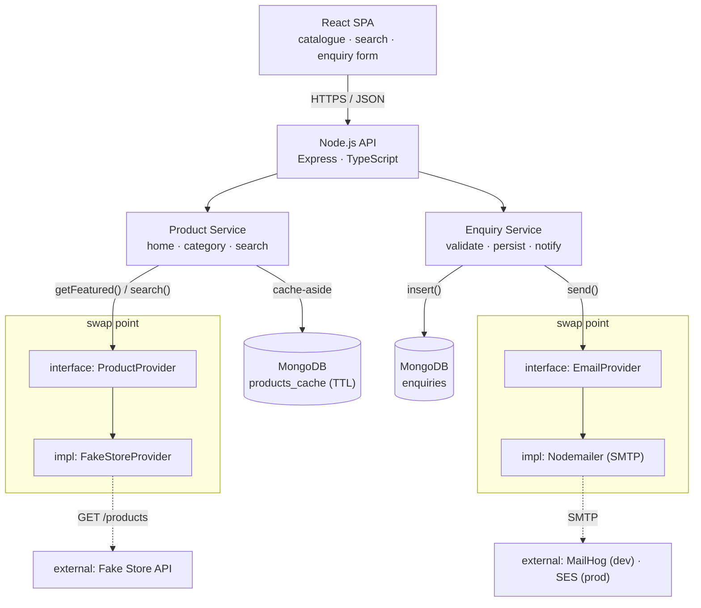
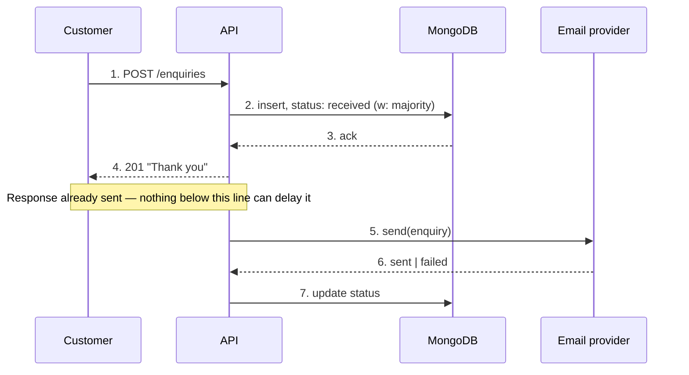
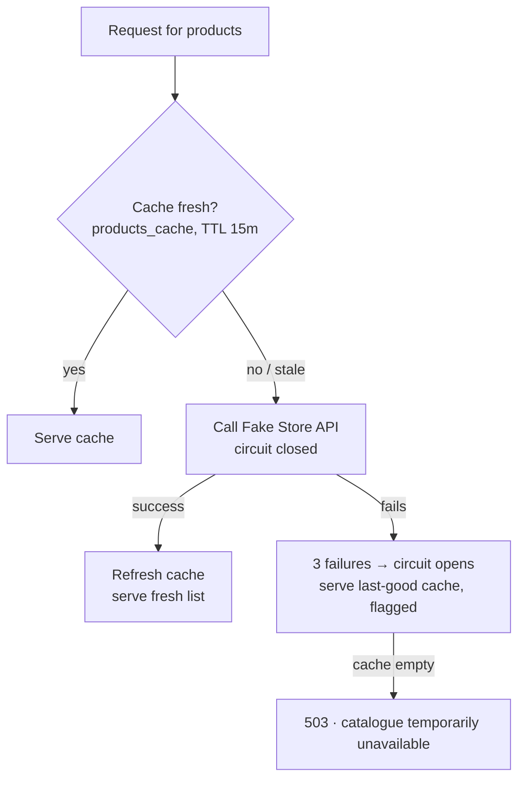
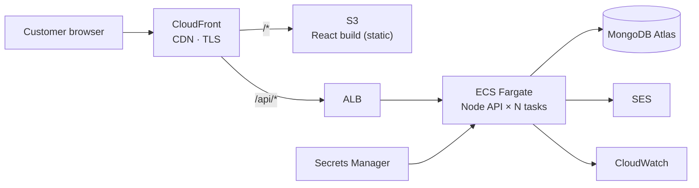

# Product Catalogue — System Design

A backend-first architecture for the AI-Native Engineer take-home: a catalogue the entrepreneur can demo today, built so the data source, look & feel, and email provider can each change without a rewrite.

**Doc:** CAT-DESIGN-01 · **Rev:** A · **Date:** 2026-11-09 · **Status:** Draft — for demo

**Stack:** React 18 (TypeScript) · Node.js + Express (TypeScript) · MongoDB · AWS (ECS Fargate, S3/CloudFront, SES)

Legend used throughout: **[PoC]** = ships in the 2–3h build · **[GROWTH]** = designed for, built later.

---

## Contents

1. [Problem & scope](#01-problem--scope)
2. [Tech stack & rationale](#02-tech-stack--rationale)
3. [High-level architecture](#03-high-level-architecture)
4. [Low-level design](#04-low-level-design)
5. [API design](#05-api-design)
6. [Data & database](#06-data--database)
7. [Scalability](#07-scalability)
8. [Consistency](#08-consistency)
9. [Fault tolerance](#09-fault-tolerance)
10. [AWS deployment](#10-aws-deployment)
11. [Security basics](#11-security-basics)
12. [Testing strategy](#12-testing-strategy)
13. [Roadmap & cuts](#13-roadmap--cuts)

---

## 01. Problem & scope

A customer-facing catalogue — browse, search, view detail, enquire — fronted by Fake Store API data, built so the data source can be swapped for a real one later without touching the client.

| Flow | Acceptance criteria, restated |
|---|---|
| Home | 5 curated "top rated" products are featured on load. |
| Category | Clicking a category shows its top-rated picks plus the rest of the category's products. |
| Search | A search term returns only products whose text matches it. |
| Product detail | Clicking a tile opens a detail page for that product. |
| Enquiry | Submitting the enquiry form emails the sales inbox and shows the customer a thank-you message. |

### Assumptions

- **"Top rated" is curated, not computed.** Fake Store API has no such field — the brief says the client *chooses* five products. Modelled as a small `featured_products` collection in MongoDB, keyed by provider product id, entirely separate from the catalogue data itself.
- **Category "top rated"** reuses the same curation set, scoped by category; if a category has no curated picks yet, the top-N by Fake Store's own `rating.rate` stand in until someone curates it.
- **Search** matches product title and description, case-insensitive, substring. Fake Store API has no search endpoint, so the backend searches its own cached copy.
- **"Sales inbox"** is one configured address via env var, not a ticketing system.
- **No accounts** for customers or admins in the PoC — curation is seeded from a JSON file rather than an admin UI (see [§13](#13-roadmap--cuts), dropped scope).
- **Currency** stays USD, matching Fake Store's data.

---

## 02. Tech stack & rationale

React, Node and MongoDB end-to-end in TypeScript, deployed to AWS — chosen against what the brief actually asks the architecture to survive: a changing data source, changing look & feel, changing email provider.

| Layer | Choice | Why it fits this brief | Trade-off accepted |
|---|---|---|---|
| Client | React 18 + TypeScript (Vite) | Component model matches the domain directly — tiles, detail view, a form. TypeScript catches drift against backend DTOs. Vite keeps "runnable in under 10 minutes" realistic. | No SSR/SEO story yet (skipped Next.js) — nothing in the brief needs it at PoC stage. |
| Backend | Node.js + Express + TypeScript | One language end-to-end. Express is boring and legible — a reviewer can read the whole request path in ten minutes. Non-blocking I/O suits a service that's mostly proxying and caching an upstream API. | No DI container (skipped NestJS) — the codebase is small enough that plain layered modules read faster than framework ceremony. |
| Database | MongoDB | The data this app actually owns — enquiries, curation, the product cache — is document-shaped and will keep changing shape as the brief evolves. Schema-on-read means a new data source is a new provider, not a migration. Native TTL indexes give the cache for free. | Give up joins/relational integrity by default — not needed yet; Mongo's multi-document transactions are there if enquiry-to-inventory consistency ever matters. |
| Hosting | AWS — ECS Fargate, S3/CloudFront, SES, Atlas/DocumentDB | Client's stated platform. Fargate avoids managing EC2. S3/CloudFront is the standard static SPA pattern. SES is the natural production swap for the email abstraction. | A long-lived Express process over Lambda — simpler to reason about than cold starts for a service this size; revisit if traffic turns bursty. |

---

## 03. High-level architecture

The brief states three things are expected to change: the product data source, the look & feel, and the email provider. The architecture's real job is making each of those a contained edit — one interface and one implementation — not a rewrite.



**The swap point is the whole pitch.** Product Service and Enquiry Service only ever call an interface — `ProductProvider`, `EmailProvider`. Replacing Fake Store API with a real PIM, or Nodemailer with SES, means writing one new implementation behind that interface; nothing above it changes.

---

## 04. Low-level design

Layered modules, not a framework's DI graph — controllers stay thin, services hold the rules, providers and repositories are the only things that know an external system exists.

### Backend module layout

```
backend/src/
  config/                 # env parsing, fails fast on missing vars
  routes/                 # HTTP → controller mapping only
  controllers/            # request/response shape, no business logic
  services/
    product.service.ts    # featured, category, search rules
    enquiry.service.ts    # validate → persist → notify
  providers/
    product/
      product-provider.ts        # interface
      fake-store.provider.ts     # implementation
    email/
      email-provider.ts          # interface
      smtp.provider.ts           # implementation (nodemailer)
  repositories/
    featured.repository.ts
    enquiry.repository.ts
    product-cache.repository.ts
  models/                 # mongoose schemas
  middleware/             # error handler, validation, rate limit
  tests/
```

### The two interfaces everything else depends on

```ts
// providers/product/product-provider.ts
interface ProductProvider {
  list(params: { category?: string; q?: string; page: number; limit: number }): Promise<Page<Product>>;
  getById(id: string): Promise<Product | null>;
  listCategories(): Promise<Category[]>;
}

// providers/email/email-provider.ts
interface EmailProvider {
  send(input: { to: string; subject: string; body: string }): Promise<{ ok: true } | { ok: false; reason: string }>;
}
```

Everything in `services/` is written against these two shapes. `FakeStoreProvider` and `SmtpProvider` are the only files that import `fetch`/`nodemailer` respectively — **[GROWTH]** a future `PimProvider` or `SesProvider` slots in beside them without touching a controller or a test for business rules.

### Key flow — enquiry submission



The enquiry is durable in MongoDB *before* the customer sees "thank you." Email delivery happens afterward and is tracked on the record, not on the response.

---

## 05. API design

One REST surface, versioned, JSON in and out. The client never sees Fake Store's shape — the backend normalises every product into its own DTO.

| Endpoint | Purpose | Key params / body |
|---|---|---|
| `GET /api/v1/products` | Browse / search | `q`, `category`, `page`, `limit` |
| `GET /api/v1/products/featured` | Home page — the curated 5 | — |
| `GET /api/v1/products/:id` | Product detail page | — |
| `GET /api/v1/categories` | Category list / nav | — |
| `GET /api/v1/categories/:slug/products` | Category page — curated + the rest | `page`, `limit` |
| `POST /api/v1/enquiries` | Submit an enquiry | `productId`, `name`, `email`, `phone?`, `message` |

### Normalised product DTO

```json
{
  "id": "21",
  "title": "Men's Casual Premium Slim Fit T-Shirts",
  "description": "Slim-fitting style, contrast raglan long sleeve...",
  "price": 22.3,
  "currency": "USD",
  "category": { "slug": "mens-clothing", "name": "Men's Clothing" },
  "images": ["https://.../71-...jpg"],
  "rating": { "average": 4.1, "count": 259 },
  "source": "fakestore"
}
```

`source` exists so a future mixed catalogue — some SKUs from Fake Store, some from a real PIM — is representable without a breaking change.

### Example — `POST /api/v1/enquiries`

**201 Created**
```json
{ "id": "662f...", "status": "received" }
```

**422 Unprocessable**
```json
{ "errors": [{ "field": "email", "message": "Enter a valid email address" }] }
```

---

## 06. Data & database

MongoDB holds the three things this app actually owns: curation, enquiries, and a cached mirror of whatever the current product provider returns.

| Collection | Shape | Indexes |
|---|---|---|
| `products_cache` | Normalised product DTO + `cachedAt` | TTL on `cachedAt` (15 min) · text index on `title`+`description` · `category.slug` |
| `featured_products` | `{ productId, category \| null, position, curatedAt }` | `category`, `position` |
| `enquiries` | `{ productId, productTitle, name, email, phone, message, status, emailAttempts, createdAt }` | `createdAt` desc · `status` |

`productTitle` is a denormalised snapshot taken at submission time — if the catalogue entry later changes or disappears, the sales team still sees what the customer actually asked about. `status` on an enquiry is `received → email_sent | email_failed`, which is also the backbone of the fault-tolerance story in [§09](#09-fault-tolerance).

> **Why MongoDB over a relational store.** Nothing here needs joins. What it needs is a shape that can change without a migration every time the brief changes — and the brief *will* change the product shape when the real data source arrives. A document per product, per enquiry, per curation entry maps directly onto that.

---

## 07. Scalability

Read-heavy catalogue traffic, write-light enquiry traffic — scale each path on its own terms.

| Lever | How it scales |
|---|---|
| API tier | Stateless Express containers behind an ALB; ECS target-tracking scales task count on CPU/requests. No session state to shard. |
| Catalogue reads | Cache-aside against `products_cache` absorbs repeat reads and shields the upstream provider from load; **[GROWTH]** Atlas replica set with `secondaryPreferred` reads once traffic outgrows one primary. |
| Search | Mongo text index on the cache handles tens of thousands of SKUs comfortably; **[GROWTH]** graduate to Atlas Search or OpenSearch if relevance ranking or facets are needed. |
| Static assets | React build on S3 behind CloudFront — scales to any traffic level without touching the API tier. |
| Enquiries | Low volume by nature (one write per interested customer); scales trivially on a single primary. |

---

## 08. Consistency

One consistency model per kind of data, not one for the whole system — enquiries can't be lost; catalogue freshness can lag a few minutes and nobody notices.

| Data | Model | Reasoning |
|---|---|---|
| Enquiries | Strong — majority write concern, synchronous ack before responding | Losing a lead is the one failure mode this app cannot absorb; see the sequence in [§04](#04-low-level-design). |
| Catalogue reads | Eventual — bounded by a 15-minute cache TTL | "Top rated" and product listings don't need millisecond freshness; a stale price for a few minutes is an acceptable trade for resilience ([§09](#09-fault-tolerance)). |
| Curation (`featured_products`) | Strong — read on every home/category request, tiny collection | Choosing what's "top rated" is a deliberate act; it should show up immediately. |

---

## 09. Fault tolerance

The two things outside this system's control are the upstream product API and the email provider — the design assumes both will fail and decides in advance what the customer sees when they do.



A down or slow Fake Store API degrades the catalogue to "possibly outdated" — it never takes the site offline unless the cache has never been populated at all.

| Failure | Behaviour | What the customer sees |
|---|---|---|
| Email provider down | Enquiry already committed to Mongo before send is attempted; status becomes `email_failed`; **[GROWTH]** background retry queue | "Thank you" immediately — unaffected |
| MongoDB primary failover | Replica set elects a new primary; driver retries writes (`retryWrites=true`) | Brief latency, no visible error |
| Backend task crash | ECS replaces the task; ALB health check routes around it | No visible impact with ≥2 tasks |
| Fake Store returns malformed data | Schema validation drops the bad record, logs it, keeps serving the rest | No visible impact |

---

## 10. AWS deployment

Every AWS service here has a free, no-account local stand-in — required by the brief, and genuinely how this gets developed day to day.



Local dev swaps every right-hand box for a Docker Compose container or a plain file — no AWS account needed to run or review this.

| AWS (target) | Local — `docker compose up` |
|---|---|
| CloudFront + S3 | Vite dev server / static container |
| ALB + ECS Fargate | Single `api` container |
| MongoDB Atlas / DocumentDB | `mongo:7` container |
| SES | MailHog container — SMTP catcher with a web UI at `:8025`, so "the sales inbox received an email" is literally visible in the browser |
| Secrets Manager | `.env` file, git-ignored, seeded from `.env.example` |
| CloudWatch | Container stdout |

---

## 11. Security basics

- **CORS** locked to the SPA's origin — the API is not a public open endpoint.
- **Input validation** at the boundary (zod) on every request body, rejecting before it reaches a service.
- **Rate limiting** on `POST /enquiries` — the one write endpoint, and the one a bot would target.
- **Helmet** for standard response headers; React escapes output by default, so reflected XSS from product text is not a live risk.
- **No raw query construction** — Mongoose/parameterised queries only, closing the injection class entirely.
- **No secrets in the repo** — `.env.example` documents every variable; real values stay in `.env` or Secrets Manager.
- **[GROWTH]** a lightweight honeypot field or CAPTCHA on the enquiry form if spam becomes real.

---

## 12. Testing strategy

Tests sit on the critical path from the acceptance criteria, not on every file — enough to change this code with confidence in a follow-up interview.

- **Providers:** unit tests against a fake `ProductProvider`/`EmailProvider` — proves the service layer never assumes Fake Store or SMTP specifically.
- **Services:** curation selection, search matching, enquiry validation — the actual business rules.
- **Integration:** `POST /enquiries` against `mongodb-memory-server` with a mocked email provider, asserting the DB write and the 201 response happen independently of email success — the exact claim in [§04](#04-low-level-design)'s diagram.
- **Client:** React Testing Library on search, product-tile navigation, and enquiry form validation.
- **[GROWTH]** Playwright E2E over the five acceptance-criteria flows end to end.

---

## 13. Roadmap & cuts

### Simplified for the 2–3 hour build, and why

- **Curation seed file instead of an admin UI** — curation is a data concern either way; a UI doesn't change the architecture story, only adds screens to build.
- **In-process retry with backoff instead of SQS + worker** — same interface, same customer-visible behaviour, far smaller footprint for a 2–3h box.
- **A failure counter + cooldown instead of a circuit-breaker library** — same external behaviour as [§09](#09-fault-tolerance)'s diagram, one dependency fewer.
- **One ECS task definition documented, not provisioned** — no AWS account the reviewer needs to create, per the brief's own constraint.
- **Unit + integration tests only, no E2E suite** — covers the critical path; a full browser suite is a day-two investment.

### With another day

- Wire the real SQS + worker retry path for email.
- Atlas Search (or OpenSearch) once SKU count or query complexity outgrows a Mongo text index.
- A simple protected curation screen, so "top rated" stops being a JSON file.
- Playwright E2E across all five acceptance-criteria flows.
- IaC (CDK or Terraform) for the AWS topology in [§10](#10-aws-deployment), instead of prose.

---

*Design document for the AI-Native Engineer take-home challenge · product catalogue PoC · React + Node.js + MongoDB on AWS.*
